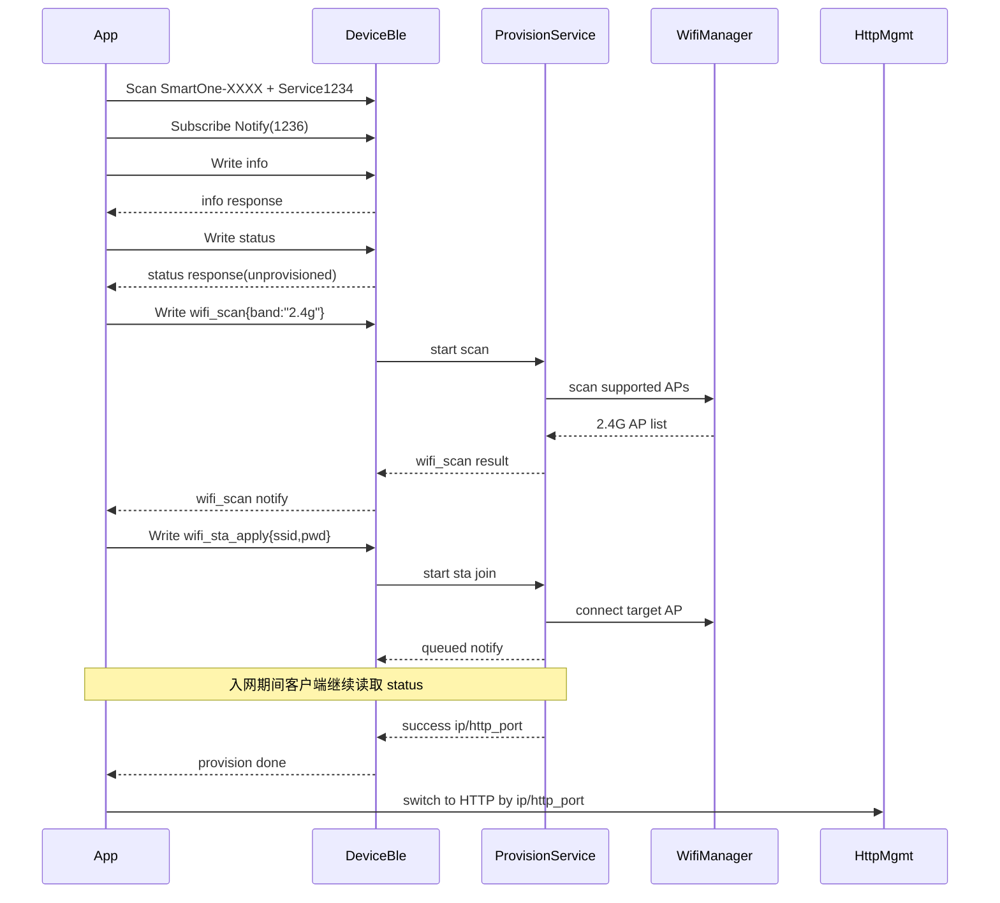
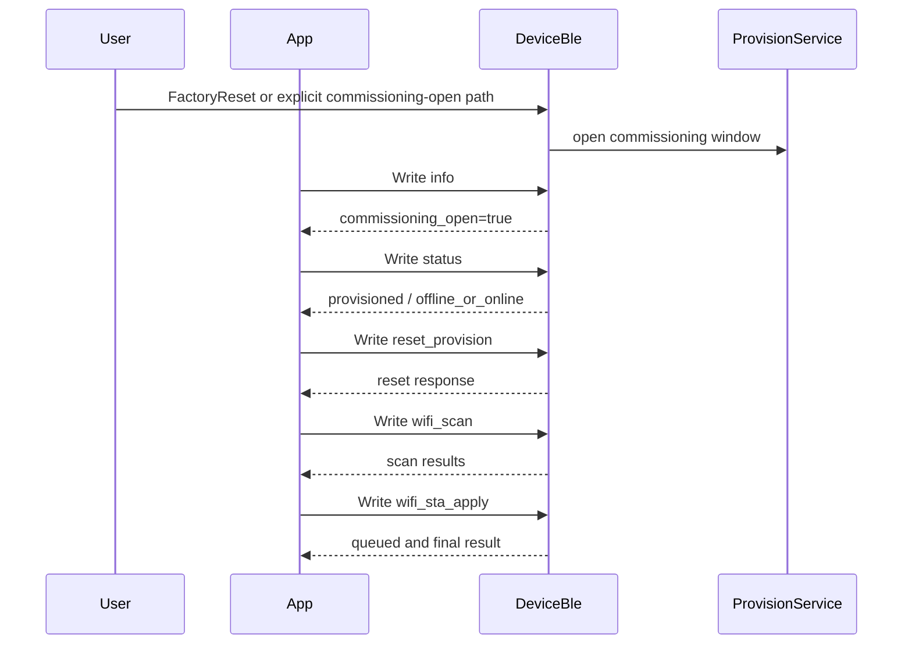
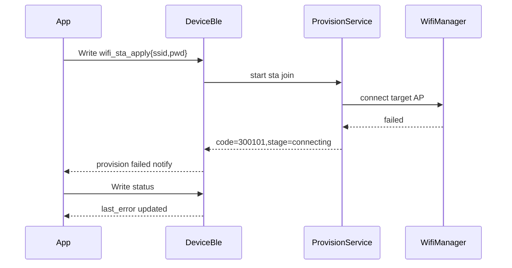
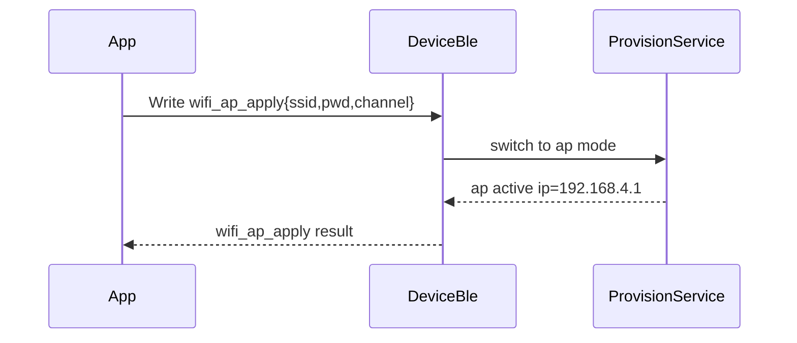
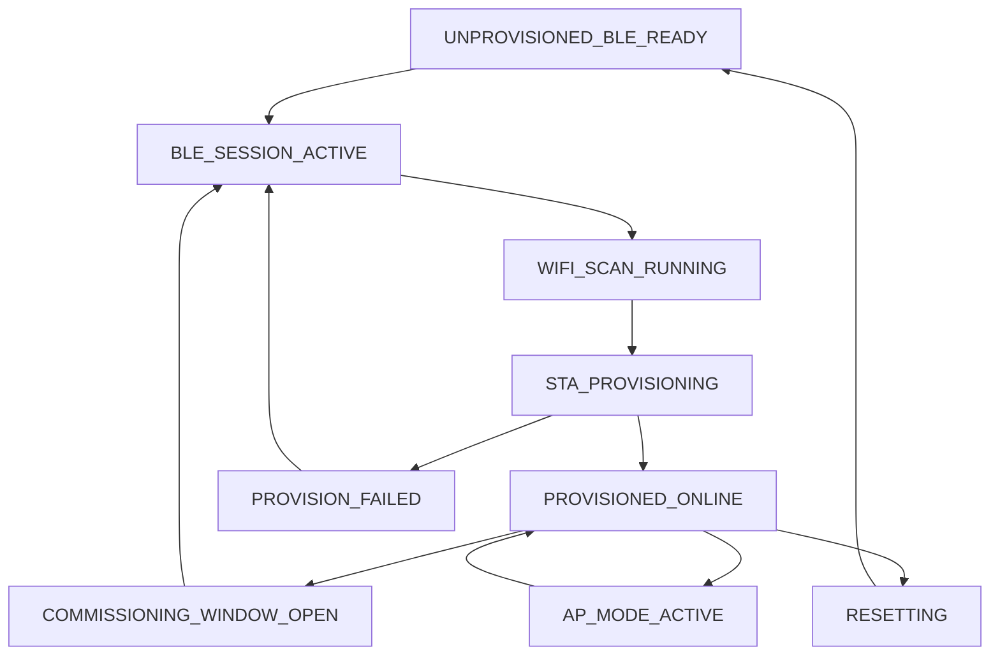

# Parkia.Cube BLE 配网时序与流程说明

## 1. 文档说明

本文档描述 Parkia.Cube BLE 配网的标准时序、异常时序和状态流转。  
默认假设：

- BLE 是首配网入口
- HTTP 仅在设备入网成功后承担管理能力
- `wifi_scan` 只返回 2.4G 热点
- 设备仅在 `commissioning_open = true` 时接受配网写入

## 2. 首次配网标准时序

### 流程说明

1. App 扫描设备时，按名称前缀 `SmartOne` 和 Service UUID `1234` 过滤。
2. App 连接后，必须先订阅 `1236`。
3. App 优先调用 `info` 和 `status`，确认设备当前是否允许配网。
4. `wifi_scan` 默认请求 `band = 2.4g`；即使客户端传 `all`，设备当前仍只返回 2.4G 列表。
5. 用户选择热点并输入密码后，App 调用 `wifi_sta_apply`。
6. 当前固件首版保证通过通知返回 `queued` 和最终成功/失败结果。
7. 若需要观察中间阶段，App 应继续读取 `status`。
8. 成功后返回 `ip` 与 `http_port`，App 转入 HTTP 管理链路。

## 3. 已配网设备重配网时序

### 流程说明

- 已配网设备默认不应长期开放写入。
- 重配网应先通过恢复出厂或显式打开配网窗口进入 `commissioning_open=true`。
- 若业务希望“先清旧配置再重配”，可先发 `reset_provision`。
- 若业务希望“直接覆盖旧配置”，可在开放窗口内直接发送 `wifi_sta_apply`。

## 4. 配网失败时序

### 流程说明

- 配网失败时必须通过 `status` 读到 `last_error`。
- 失败不应清空最后一次已知可用配置。
- 失败后应优先恢复上一次成功模式：先前在 `STA` 就回 `STA`，先前在 `AP` 就回 `AP`。
- 若设备当前仍处于开放配网窗口，App 可再次发送 `wifi_sta_apply`。

## 5. 设备 AP 模式切换时序

### 流程说明

- `wifi_ap_apply` 应视为高级接口。
- 对普通用户流程，可不暴露此接口。
- 对售后/维护场景，可保留该接口以便设备切回 AP 模式。

## 6. 状态流转图

## 7. 状态定义

### `UNPROVISIONED_BLE_READY`

- 含义：设备未配网，BLE 已广播，可接受配网命令
- 可用接口：`info`、`status`、`wifi_scan`、`wifi_sta_apply`、`wifi_ap_apply`、`reset_provision`

### `BLE_SESSION_ACTIVE`

- 含义：已有客户端连接并持有写会话
- 可用接口：同上，但其他客户端若发写请求应收到 `busy`

### `WIFI_SCAN_RUNNING`

- 含义：设备正在扫描可用热点
- 可用接口：`status`
- 备注：当前扫描结果只返回 2.4G AP

### `STA_PROVISIONING`

- 含义：设备正在连接目标家庭 Wi-Fi
- 可用接口：`status`
- 备注：当前固件首版保证通过通知收到 `queued` 和最终成功/失败；中间阶段应读 `status`

### `PROVISIONED_ONLINE`

- 含义：设备已成功连网
- 可用接口：`info`、`status`
- 备注：默认不允许再次写入配网命令，除非重新打开配网窗口

### `PROVISION_FAILED`

- 含义：最近一次配网失败
- 可用接口：`status`、`wifi_scan`、`wifi_sta_apply`
- 备注：前提是 `commissioning_open = true`

### `AP_MODE_ACTIVE`

- 含义：设备当前作为热点运行
- 可用接口：`info`、`status`

### `RESETTING`

- 含义：设备正在清除保存的配网信息
- 可用接口：`status`

## 8. 客户端实现建议

- 连接后必须立即订阅 `1236`
- 所有写命令必须带 `req_id`
- 在首版实现里，App 应默认调用 `wifi_scan{band:\"2.4g\"}`
- 不应把 `5g` 或 `all` 解释为当前版本支持 5G 扫描或 5G 配网
- 收到 `busy` 时，App 应提示“设备正在被其他手机配置”
- 收到成功结果后，App 立即切换到 `ip:http_port` 进行 HTTP 管理访问

## 9. 对外文档使用建议

对外开放时，本文件应与以下文档配套发布：

- `BLE_Provisioning_Protocol.md`
- `BLE_Provisioning_Field_Definitions.md`

其中：

- 协议说明文档回答“有哪些接口、怎么调用”
- 字段定义文档回答“字段是什么意思、枚举代表什么”
- 本文回答“客户端按什么顺序调、失败怎么恢复”
